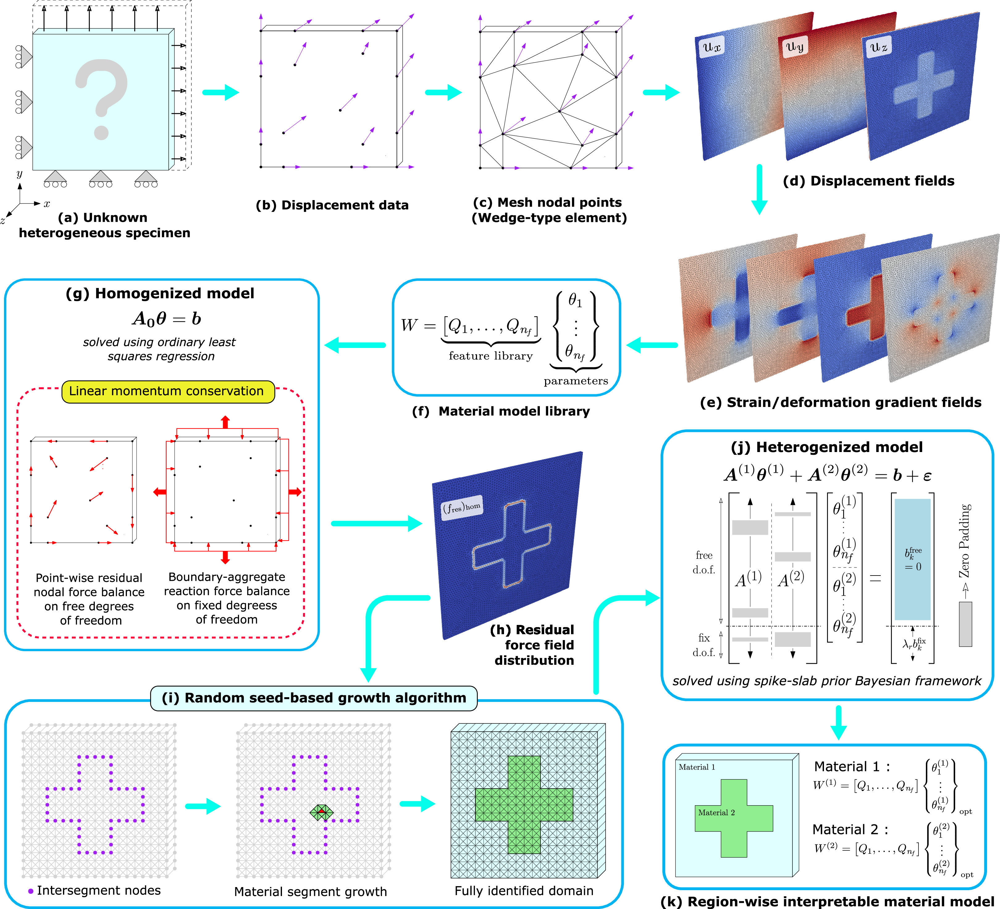

# Hetero-EUCLID

**Interpretable model discovery for heterogeneous hyperelastic materials using stress-unsupervised learning**

[](https://doi.org/10.1016/j.cma.2026.118729)
[](LICENSE)

This repository contains the code and example datasets for the paper:

> K. L. Chaurasiya, S. Dutta, S. Kumar, A. Joshi.
> **Hetero-EUCLID: Interpretable model discovery for heterogeneous hyperelastic materials using stress-unsupervised learning.**
> *Computer Methods in Applied Mechanics and Engineering*, 452, 118729 (2026).
> https://doi.org/10.1016/j.cma.2026.118729

Developed at the [Dynamics, Data and Design (D3) Lab](https://d3lab-iisc.github.io/), Department of Mechanical Engineering, Indian Institute of Science (IISc) Bengaluru.

## Workflow



**(a–e)** Surface displacements of an unknown heterogeneous specimen (from FE simulations, or from DIC/DVC in experiments) are mapped onto a wedge-element mesh to obtain strain fields. **(f–g)** A homogenized model, built from a library of constitutive features, is fitted to the linear momentum balance by least squares. **(h–i)** The residual force field of this fit highlights the material interfaces, and a random seed-based growth algorithm segments the domain into material regions. **(j–k)** A heterogenized model with one parameter set per region is solved with the spike-and-slab Bayesian framework, giving an interpretable material model for each region.

## Repository structure

```
Hetero-EUCLID/
├── core/                                   # Solver modules (adapted from Bayesian-EUCLID)
│   ├── core_spike_slab.py                  # Hierarchical Bayesian spike-and-slab Gibbs sampler
│   ├── truncated_multivariate_normal.py    # Minimax-tilting TMVN sampler (Botev 2016; impl. P. Brunzema)
│   ├── unsupervised_hyperelasticity.py     # Data containers, filtering and processing of A, b
│   ├── load_fem_data_wedge_2intpoints.py   # FE data loader (wedge elements), noise + KRR denoising
│   ├── data_definitions.py, utilities.py   # Kinematics, invariants, reference state
│   ├── helper.py, post_process.py          # Misc. helpers and plotting
├── drivers/
│   ├── main_hss_hetero_euclid.py           # Main entry point
│   ├── config.py                           # Hyperparameters (priors, chain length, seed, ...)
│   ├── features_library.py                 # Constitutive feature library
│   ├── preprocess_data_hetero.py           # Assembles the linear system per material cluster
│   ├── growth_paraview_2_residualForces.py # Residual-force based segmentation (island growth)
│   └── paraview_plot.py                    # Writes .vtk output for ParaView
├── main_data/
│   ├── Type1_Cross_Shaped_Inclusion/{1..6}/  # FE data per load step
│   └── Type2_Split_Domain/{1..6}/
├── docs/graphical_abstract.jpg            # Workflow schematic
├── HeteroEUCLID.yml                        # Exact conda environment (Windows)
└── requirements.txt                        # Cross-platform pip requirements
```

Each load-step folder contains the FE data used as input:

| File | Content |
|---|---|
| `output_nodes.csv` | Node id, reference coordinates `x,y,z`, displacements `ux,uy,uz`, Dirichlet BC flags `bcx,bcy,bcz`, `mat_id` |
| `output_elements.csv` | 6-node wedge connectivity `node1..node6`, ground-truth `mat_id` |
| `output_reactions.csv` | Boundary-averaged reaction forces |

## Installation

The code was developed and tested with Python 3.12 on Windows. Clone the repository first:

```bash
git clone https://github.com/d3lab-iisc/Hetero-EUCLID.git
cd Hetero-EUCLID
```

### Option A: conda (exact environment, Windows)

`HeteroEUCLID.yml` pins the exact package builds used for the paper. It is Windows-specific.

```bash
conda env create -f HeteroEUCLID.yml
conda activate HeteroEUCLID
```

### Option B: pip (any OS)

```bash
python -m venv .venv
# Windows:
.venv\Scripts\activate
# Linux / macOS:
source .venv/bin/activate

pip install -r requirements.txt
```

The code runs on the CPU. On Linux, you can install the smaller CPU-only PyTorch wheel first with `pip install torch==2.3.0 --index-url https://download.pytorch.org/whl/cpu`, then run `pip install -r requirements.txt`.

## Usage

The scripts use paths relative to `drivers/`, so run them from that folder:

```bash
cd drivers
python main_hss_hetero_euclid.py <case> <noise>
```

| Argument | Values |
|---|---|
| `<case>` | `Type1_Cross_Shaped_Inclusion`, `Type2_Split_Domain` (any folder name inside `main_data/`) |
| `<noise>` | `none` (0), `low` (1e-3), `moderate` (2e-3), `high` (5e-3): the standard deviation of the Gaussian displacement noise |

Examples:

```bash
python main_hss_hetero_euclid.py Type1_Cross_Shaped_Inclusion none
python main_hss_hetero_euclid.py Type2_Split_Domain moderate
```

Hyperparameters such as the spike-and-slab priors (`a_v, b_v, a_p, b_p, a_sigma, b_sigma`), the chain length, the burn-in, the number of parallel chains and the random seed are set in [`drivers/config.py`](drivers/config.py).

### Noisy cases

For `low`, `moderate` or `high`, the script first copies the case to `main_data/<case>_denoised_<level>/` and works on that copy, so the original data is not changed. The denoised displacements overwrite `output_nodes.csv` in the copy. **Delete that folder before running the same noise level again**, otherwise the noise is added a second time to data that has already been denoised.

## Output

The results are written to the analysed load-step folder (`main_data/<case>/6/`):

| File | Content |
|---|---|
| `theta_stats.csv` | Posterior mean (`theta_j`) and standard deviation (`std_j`) of the material parameters. There is one row per segmented material island. The last column is the wall-clock time |
| `theta_ols.csv` | Least-squares estimate of the parameters per island (for reference) |
| `chain.pkl` | Combined MCMC chains (pickled `Chain` object) |
| `output_elements.csv` | Updated in place with the segmentation result (`island_id` column) |
| `residuals_*.csv`, `thresholding_res_mask.csv` | Residual forces and the mask used for segmentation |
| `step_6_output.vtk` | Mesh with the segmentation and residual fields, for viewing in ParaView |
| `A1.csv, b1.csv, A2.csv, b2.csv, features.csv, ...` | Intermediate assembled system (large files, regenerated on every run) |

The parameter columns `theta_0 … theta_5` correspond to the feature library in `drivers/features_library.py`:

| Index | Feature |
|---|---|
| 0 | $(\tilde I_1 - 3)$ |
| 1 | $(\tilde I_2 - 3)$ |
| 2 | $(\tilde I_1 - 3)^2$ |
| 3 | $(\tilde I_1 - 3)(\tilde I_2 - 3)$ |
| 4 | $(\tilde I_1 - 3)^3$ |
| 5 | $(J - 1)^2$ |

Here $\tilde I_1 = I_1 J^{-2/3}$ and $\tilde I_2 = I_2 J^{-4/3}$ are the isochoric invariants of the right Cauchy–Green tensor.

## Citation

If you use this code, please cite:

```bibtex
@article{chaurasiya2026heteroeuclid,
  title   = {Hetero-EUCLID: Interpretable model discovery for heterogeneous hyperelastic materials using stress-unsupervised learning},
  author  = {Chaurasiya, Kanhaiya Lal and Dutta, Saurav and Kumar, Siddhant and Joshi, Akshay},
  journal = {Computer Methods in Applied Mechanics and Engineering},
  volume  = {452},
  pages   = {118729},
  year    = {2026},
  doi     = {10.1016/j.cma.2026.118729}
}
```

and the Bayesian-EUCLID framework it builds on:

```bibtex
@article{joshi2022bayesian,
  title   = {Bayesian-EUCLID: Discovering hyperelastic material laws with uncertainties},
  author  = {Joshi, Akshay and Thakolkaran, Prakash and Zheng, Yiwen and Escande, Maxime and Flaschel, Moritz and De Lorenzis, Laura and Kumar, Siddhant},
  journal = {Computer Methods in Applied Mechanics and Engineering},
  volume  = {398},
  pages   = {115225},
  year    = {2022},
  doi     = {10.1016/j.cma.2022.115225}
}
```

## Acknowledgements

- The Bayesian solver in `core/` (hierarchical spike-and-slab prior with Gibbs sampling) and the kinematics utilities are adapted from [Bayesian-EUCLID](https://github.com/EUCLID-code/EUCLID-hyperelasticity-bayesian) (Joshi et al., *CMAME* 2022). Its [documentation](https://euclid-code.github.io/EUCLID-hyperelasticity-bayesian/mkdocs/site/) describes these modules in detail.
- `core/truncated_multivariate_normal.py` is taken from Paul Brunzema's [truncated-mvn-sampler](https://github.com/brunzema/truncated-mvn-sampler), a Python implementation of the minimax-tilting method of Botev (2016).

## License

This project is released under the [GNU General Public License v3.0](LICENSE), the same license as Bayesian-EUCLID, on which it is based.

## Contact

This code is maintained by the [D3 Lab](https://d3lab-iisc.github.io/) at IISc Bengaluru.